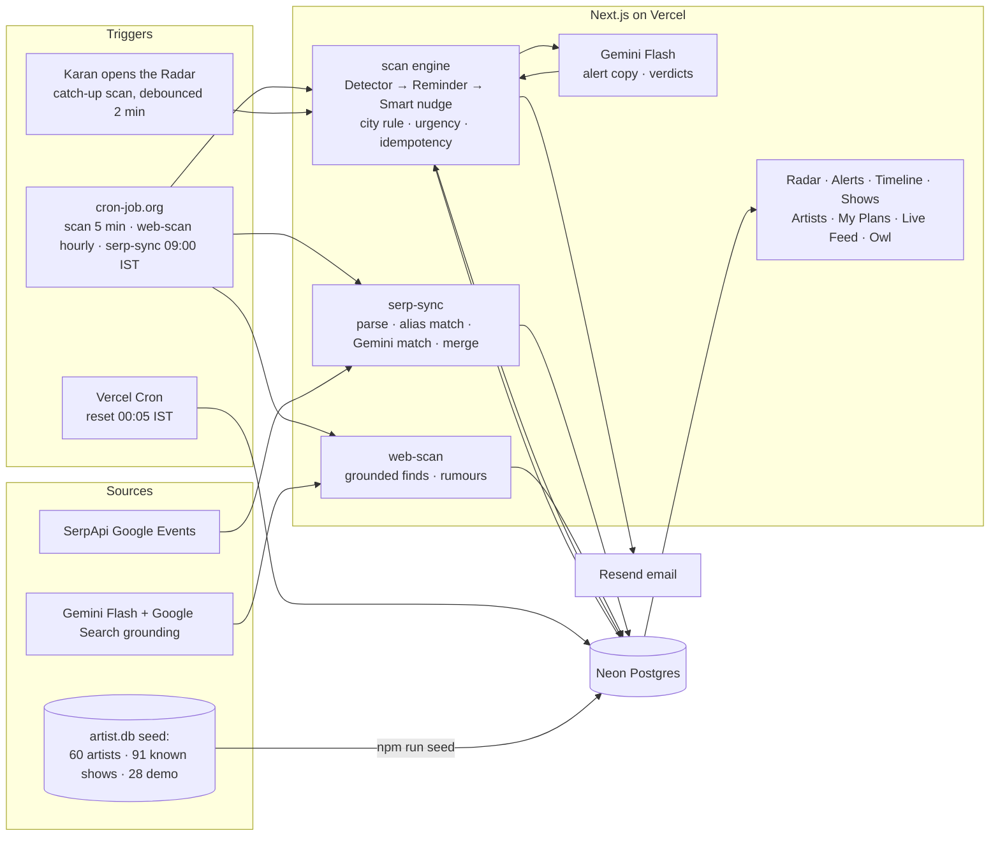

# Live Show Radar

An AI-powered live-show alert agent for **Karan**, who follows 60 artists and keeps missing their India shows. The radar watches the concert and festival calendar for every artist he follows, and the moment a show is announced in India it alerts him: **artist, venue, date, and whether the early-bird is open, imminent or about to close**. Bengaluru comes first; Mumbai and Chennai alert for Must-see artists (with a *Worth-the-trip* verdict); every other city stays visible on the Shows page.

- **Live data:** SerpApi Google Events (Bengaluru, Mumbai, Chennai, Delhi plus monthly Must-see artist sweeps) and an hourly **Gemini Flash web scan with Google Search grounding**.
- **All AI runs on Gemini Flash** (model id from `GEMINI_MODEL`). No Anthropic SDK is used anywhere.
- **Hosted on Vercel** · Neon Postgres · Resend email · cron-job.org.
- Components Map: [`docs/components-map.pdf`](docs/components-map.pdf)

## Architecture



**Facts are never written by AI.** Dates, prices, venues and deadlines are rendered from the database. Gemini writes only the one-liner and the verdict reason, and a deterministic guard (`lib/logic/copy-guard.ts`) rejects any AI text that mentions a date, time, price, deadline or venue (falling back to a template).

## Brief → feature

| What the brief says | How Live Show Radar answers it |
|---|---|
| Found out a week before, already sold out | Detector catches announcements on the next 5-minute scan; sold-out/passed shows land in **My Plans → Missed** |
| Didn't know the artist was coming to India | All 60 artists monitored: city feeds + monthly per-artist SerpApi sweeps + hourly Gemini grounded web scan |
| Saw the Instagram post 2 days late, early-bird gone | Early-bird status and exact IST deadline in every alert; **critical** when < 48 h; **Smart nudge** after 6 h of no action |
| Early-birds vanish in 6 hours | 13:00 Kayan demo drop: 6-hour early-bird, one critical email with the deadline first |
| Bengaluru first, anywhere in India worth knowing | City rule from `alert_rules`: Bengaluru = every artist; Mumbai/Chennai = Must-see; others visible only |
| Mumbai/Chennai show is a decision worth making | **Worth-the-trip** verdict (Gemini Flash, rules fallback): priority, weekend, clashes, also-plays-Bengaluru, notice, genre |
| Concert *and festival* calendar | Festival rows; two+ followed artists at one festival + city + date = **one combined alert** |
| Live external data, Gemini Flash only, Vercel | SerpApi + Gemini grounding; **Live Feed** page shows every call, its raw JSON and the quota |

## Where the data comes from

| Source | Badge |
|---|---|
| SerpApi Google Events (primary, live) | `Live · SerpApi · fetched 2h ago` |
| Gemini Flash grounded web scan (hourly, 3 artists per run) | `Gemini web` (finds without a source URL go to **Rumours**, never alerted) |
| 91 known real listings from `artist.db`, each with a source link | `Known real show` |
| 28 demo shows dated relative to today | `Demo` |
| Simulated early-bird windows on real shows | `Simulated early-bird` (always shown, in UI and email) |

Where to buy follows `ticket_source_rules`: SerpApi `ticket_info` platform name → site name of the SerpApi ticket link → known platform → "Check BookMyShow". The app never scrapes ticketing sites.

## Alerts

| Engine | Type | Fires when | Urgency |
|---|---|---|---|
| Detector | `new_show` | announced (demo: at its drop time) | critical for Bengaluru + Must-see, or early-bird closing < 48 h; else high |
| Detector | `festival` | ≥ 2 followed artists, same festival + city + date | as above |
| Detector | `eb_sold_out` / `general_sold_out` | a tier changes to sold out | high |
| Reminder | `eb_live` | early-bird opened today | critical |
| Reminder | `eb_closing` | closes within 48 h | critical |
| Reminder | `decide_soon` | show ≤ 14 days away, no status | medium |
| Reminder | `show_week` / `tonight` | exactly 7 days / today, status Going | low |
| Reminder | `missed` | passed or sold out with no action | info (dashboard only) |
| Smart nudge | `nudge` | critical alert, 6 h without action, early-bird still open (once per show) | critical |

**Skip** silences every reminder for that show. Every reminder fires at most once per show, and early-bird reminders are folded into an announcement that already carried the deadline, so each demo drop sends **one** email. Idempotency key: `show_id:type:IST-date` (unique in Postgres); running `/api/cron/scan` twice creates nothing new.

## Environment variables

| Variable | Required | Notes |
|---|---|---|
| `DATABASE_URL` | yes | Neon **pooled** connection string |
| `CRON_SECRET` | yes | long random string; every `/api/cron/*` call needs `Authorization: Bearer <CRON_SECRET>` |
| `GEMINI_API_KEY` | for AI | without it: template copy, rule verdicts, alias-only matching, no web scan |
| `GEMINI_MODEL` | for AI | current Gemini **Flash** model id (the only place the model is named) |
| `SERPAPI_API_KEY` | for live data | without it: SerpApi sync is skipped and logged |
| `SERPAPI_MONTHLY_QUOTA` | no (250) | set to 100 if your SerpApi plan shows 100 |
| `RESEND_API_KEY` | for email | |
| `ALERT_EMAIL` | for email | Karan's inbox; for the demo, the Resend account owner's email |
| `EMAIL_FROM` | no | `onboarding@resend.dev` |
| `APP_URL` | yes in prod | `https://<project>.vercel.app` (used in email buttons) |
| `EMAIL_DRY_RUN` | no | `true` logs emails instead of sending |

Missing `DATABASE_URL`/`CRON_SECRET` fails loudly at startup. Missing service keys are reported loudly at startup and the app runs in degraded mode (cached data + fallbacks) — it still renders with SerpApi and Gemini keys removed.

> **Resend note:** until you verify a domain in Resend, `onboarding@resend.dev` can only send to the Resend account owner's email. Use that address as `ALERT_EMAIL` for the demo.

## Local setup

```bash
npm install
cp .env.example .env.local      # fill in the values
npm run dev:db                  # optional: local Postgres on :54330 (embedded-postgres); or point DATABASE_URL at Neon
npm run db:migrate              # apply drizzle/ migrations
npm run seed                    # import data/artist.db → expect 60 artists, 91 known, 28 demo
npm run dev
npm test                        # Vitest: date/year inference, city detection, alias matching, city rule,
                                # urgency, reminders, nudge, idempotency (incl. IST midnight), ticket source, FOMO
```

`npm run seed` is re-runnable: reference tables are upserted (Karan's priority toggles survive), demo shows are reset, and real shows only get their simulated early-bird windows re-anchored to today.

## Deploy (Vercel + Neon)

1. Create a Neon project/database; copy the **pooled** connection string.
2. Locally, with `DATABASE_URL` pointing at Neon: `npm run db:migrate && npm run seed`.
3. Import the GitHub repo in Vercel; add every env var above (Production); deploy.
4. Set `APP_URL` to the Vercel URL and redeploy.
5. `vercel.json` registers the daily reset cron (`5 18 * * *` UTC = 00:05 IST). Vercel sends `Authorization: Bearer $CRON_SECRET` automatically.
6. Check `GET /api/health`.

## Scheduling with cron-job.org (free)

Vercel Hobby only runs daily crons, so the frequent jobs live on cron-job.org. For each job: method **POST** (GET also works), header `Authorization: Bearer <CRON_SECRET>`, timeout 60 s+.

| Job | URL | Schedule |
|---|---|---|
| Alert scan | `https://<app>/api/cron/scan` | every 5 minutes |
| Gemini web scan | `https://<app>/api/cron/web-scan` | every hour |
| SerpApi sync | `https://<app>/api/cron/serp-sync` | daily 09:00 Asia/Kolkata |
| Daily reset | Vercel Cron (`vercel.json`) | 00:05 IST |

The SerpApi plan in `serp_query_plan` is ≈ 173 searches/month (4 cities daily, pages 2–3 weekly, 23 Must-see sweeps monthly); a quota guard never lets a run exceed `SERPAPI_MONTHLY_QUOTA`. Google Events date filters only reach "next month", so the 6-month horizon comes from pagination and the per-artist sweeps.

## Demo script for the professor

1. **Open the Radar** (`/`). Top card = the next thing to act on, with a live countdown. *Today's drops* shows the 13:00 / 15:00 / 17:00 / 19:00 / 21:00 IST demo drops — dropped ones reveal the artist, upcoming ones count down. Opening the page also runs a debounced catch-up scan.
2. **Critical / This week / Bengaluru / Out of town**: every card has artist, venue, city, date, early-bird status with countdown, source badge, where-to-buy and Going (early-bird) / Going (general) / Interested / Skip. Mumbai/Chennai Must-see cards carry a verdict chip.
3. **Alerts** (`/alerts`): unread dots, filters, and the email tick on each alert. The 13:00 Kayan drop is one critical email with the 7 PM deadline; Swadesi and Guns N' Roses get a Smart nudge 6 h after their critical alert.
4. **Live Feed** (`/live-feed`): press **Sync now** (rate-limited to once an hour) → a real SerpApi Google Events call appears in the call log with results / matched / new shows, and the quota meter moves. Open **JSON** on any listing to see the raw SerpApi item next to the show it became.
5. **Open the email** in the inbox (`ALERT_EMAIL`): headline + Gemini one-liner, a fact block from the database, early-bird deadline in IST, Simulated/Demo tags, verdict (Mumbai/Chennai Must-see) and "Tickets via … · found by SerpApi Google Events".
6. **Timeline**, **Shows** (city / festival / alerting filters), **Artists** (priority toggles), **My Plans** (FOMO Meter).
7. Tap the **Owl** 🦉: it flies, then reports when the radar last checked. It only reads the logs — scanning runs on its own every 5 minutes.

## Project layout

```
app/                 pages (Radar, alerts, timeline, shows, artists, plans, live-feed) + API routes
app/api/cron/*       scan · serp-sync · web-scan · reset (CRON_SECRET protected)
lib/logic/           pure, unit-tested business rules
lib/engine/scan.ts   Detector → Reminder → Smart nudge → copy → idempotent alerts → email
lib/serp/            SerpApi client, parsing, matching, merge
lib/web/scan.ts      Gemini grounded web scan
lib/ai/              Gemini wrapper (timeout, retry, zod) + every prompt in prompts.ts
lib/seed/            artist.db → Postgres anchoring (shared by seed + daily reset)
scripts/seed.ts      the only place better-sqlite3 is used
data/artist.db       seed data · docs/components-map.pdf
```
